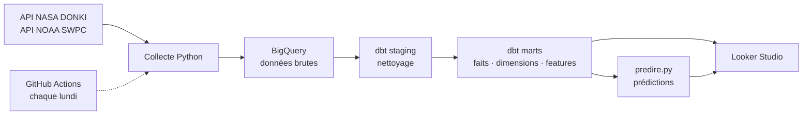
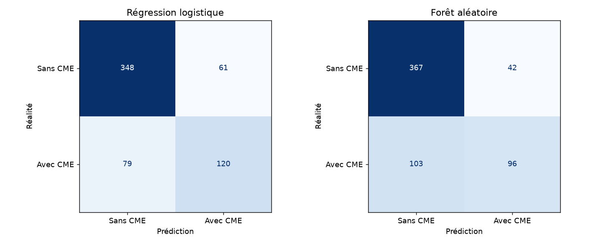

# ☀️ SkyWatch — Météo spatiale

**Peut-on prévoir, dès la fin d'une éruption solaire, si elle sera suivie d'une éjection de masse coronale (CME) ?**

Pipeline de données de bout en bout à partir des données ouvertes de la NASA : collecte d'API, entrepôt BigQuery, modélisation dbt, modèle de Machine Learning et tableau de bord.

📊 **[Voir le tableau de bord Looker Studio](https://datastudio.google.com/reporting/3ec43c75-d20f-4af2-bd2a-a20d25e7410d)**

---

## Le contexte

Une éruption solaire envoie trois choses vers la Terre : des rayons X (8 minutes), des particules (quelques heures) et parfois une **CME**, qui arrive en **1 à 3 jours**. C'est la CME qui provoque les tempêtes géomagnétiques : en 1989, l'une d'elles a privé 6 millions de Québécois d'électricité.

Prévoir la CME dès la fin de l'éruption, c'est gagner ces 1 à 3 jours pour agir.

**Cliente fictive (persona)** : Rachel Kim, coordinatrice de la gestion des urgences au Colorado. Elle veut une alerte claire, fiable, et voir la donnée derrière chaque score.

## Mon rôle

Projet réalisé en équipe de trois à la Wild Code School (projet *Wild Data Hub*, août-octobre 2026), avec Alison Bourdet (astéroïdes) et Sofiane BenAbbou (catastrophes naturelles). L'infrastructure était commune ; **j'étais responsable du périmètre météo spatiale**, dont ce dépôt présente le code :

- collecte des API NASA DONKI et NOAA SWPC ;
- modèles dbt (staging et marts) ;
- analyse exploratoire ;
- modèle de Machine Learning et script de prédiction ;
- tableau de bord Looker Studio.

## Architecture



| Couche | Contenu |
|---|---|
| **Bronze** | Données brutes des API, chargement incrémental (empreinte `row_hash`, `WRITE_APPEND`) |
| **Silver** | Staging dbt : noms alignés, types, dédoublonnage par `row_number()` |
| **Gold** | Marts dbt en constellation : 2 tables de faits, dimensions partagées, table de features ML |

**80 tests dbt** (unicité, valeurs non nulles, intégrité référentielle) à chaque exécution.

## Le modèle de Machine Learning

- **Problème** : classification binaire supervisée, éruption M ou X → CME oui/non.
- **Données** : 2 453 éruptions M et X depuis 2015, dont 27 % suivies d'une CME.
- **Variables** : 8 variables connues à la fin de l'éruption (intensité, durée, temps de montée, position, historique de la région), calculées sans regarder le futur.
- **Pipeline scikit-learn** : imputation par la médiane, `StandardScaler`, `OneHotEncoder`, `LogisticRegression(class_weight="balanced")`.
- **Comparaison** : modèle naïf, forêt aléatoire, régression logistique (retenue).
- **Évaluation** : découpage temporel, entraînement avant 2025, test sur 608 éruptions de 2025-2026.

| Indicateur (seuil 0,4) | Résultat |
|---|---|
| CME détectées (rappel) | **71 %** |
| Alertes confirmées (précision) | **55 %** |
| CME réelles au niveau de risque « Très élevé » | **83 %** |
| CME réelles au niveau de risque « Faible » | **9 %** |

Le seuil est abaissé à 0,4 : pour un réseau électrique, manquer une CME coûte plus cher qu'une fausse alerte.



## Difficultés rencontrées

- **Biais de catalogage** : DONKI n'est exhaustif qu'à partir de la classe M1.0. L'analyse et le modèle sont limités aux classes M et X.
- **Deux numérotations des régions solaires** : règle trouvée, région DONKI = région NOAA + 10 000.
- **Durées aberrantes** : 4 valeurs filtrées (0 à 600 minutes conservées).
- **Migration de l'API NASA** (30 septembre 2026) : pipeline en échec, diagnostiqué et corrigé le jour même.

## Structure du dépôt

```
collecte/          scripts de collecte DONKI et NOAA, notebooks d'exploration
transformation/    modèles dbt (staging, marts) et seed NOAA
analyse/           analyse exploratoire
ml/                entraînement, modèle sauvegardé, script de prédiction, graphiques
```

> Ce dépôt présente ma partie du projet. Les éléments communs à l'équipe (configuration dbt, dimension date, orchestration du pipeline) restent dans le dépôt d'équipe. Les identifiants sont lus depuis un fichier `.env` non versionné.

## Stack

Python · pandas · requests · BigQuery · dbt · scikit-learn · GitHub Actions · Looker Studio · Git

---

**Oumaïma Elazhari** · [LinkedIn](https://linkedin.com/in/oumaima-elazhari-558413148)
